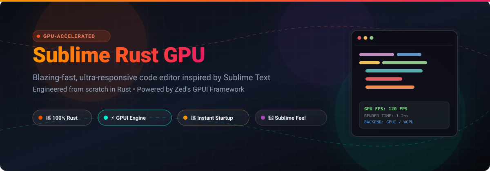

<div align="center">

<a href="https://github.com/ishandutta2007/Awesome-Awesome-Awesome"></a><a href="https://discord.gg/jc4xtF58Ve"></a>
[](https://github.com/ishandutta2007/sublime-rust-gpu/stargazers)
[](https://github.com/ishandutta2007/sublime-rust-gpu/network/members)
[](https://www.rust-lang.org/)
[](https://opensource.org/licenses/MIT)
[](https://github.com/ishandutta2007/sublime-rust-gpu/issues)
<a href="https://github.com/ishandutta2007"></a>

<br/>
<br/>



# ⚡ Sublime Rust GPU 🦀

**A high-performance, GPU-accelerated modern text editor inspired by Sublime Text, written in 100% Rust using the GPUI framework.**

---

[](https://github.com/ishandutta2007/sublime-rust-gpu)
[](https://github.com/ishandutta2007/sublime-rust-gpu)

> 💡 *Looking for the non-GPU lightweight edition? Check out [Sublime Rust CPU](https://github.com/ishandutta2007/sublime-rust-cpu).*

</div>

<br/>

## 📖 Overview

**Sublime Rust GPU** is an open-source, ultra-fast code editor engineered to blend the beloved minimalism, rapid responsiveness, and clean aesthetics of **Sublime Text** with modern hardware-accelerated graphics. Built from the ground up in **Rust**, it utilizes Zed's high-speed **GPUI engine** for silky-smooth 60+ FPS text rendering and instant keystroke latency.

---

## ✨ Key Features & Highlights

- ⚡ **GPU-Accelerated Rendering:** Powered by GPUI (the engine driving Zed), providing instantaneous frame times and zero typing lag.
- 🦀 **Memory-Safe & Blazing Fast:** Built entirely in Rust for maximum concurrency, safety, and near-zero idle resource consumption.
- 🎨 **Minimalist & Distraction-Free UI:** Recreating the beloved, clean, and elegant editor aesthetics of Sublime Text.
- 🚀 **Lightning Fast Startup:** Launches instantly with minimal cold-start overhead compared to Electron-based editors.
- 🧩 **Modular Architecture:** Clean decoupled modules for state management, buffer operations, and rendering pipeline.
- 🖥️ **Cross-Platform:** Designed to run seamlessly across Windows, macOS, and Linux.

---

## 🎯 Project Goals

| Feature / Goal | Description |
| :--- | :--- |
| 🏎️ **Unrivaled Performance** | Harnessing native compilation and GPU shaders for rapid text manipulation |
| 🪶 **Sublime Minimalism** | Maintaining a lightweight footprint without bloated background processes |
| 🔌 **Extensibility** | Future-proof architecture built for custom keymaps, themes, and extensions |
| 🖥️ **Modern GPUI UI** | Fluid animations, crisp typography, and sub-pixel precision rendering |

---

## 🚀 Getting Started

### 📋 Prerequisites

Ensure you have the following installed on your system:

- 🦀 **[Rust & Cargo](https://rustup.rs/)** (latest stable release recommended)
- 🎮 **GPU with compatible graphics drivers** (Vulkan, Metal, or DirectX 12)
- 📦 **GPUI System Dependencies:** Refer to the [Zed GPUI build instructions](https://github.com/zed-industries/zed/tree/main/crates/gpui) for OS-specific native graphics libraries.

### 📥 Installation & Build

1. **Clone the repository:**
   ```bash
   git clone https://github.com/ishandutta2007/sublime-rust-gpu.git
   cd sublime-rust-gpu
   ```

2. **Run in development mode:**
   ```bash
   cargo run
   ```

3. **Build optimized release binary:**
   ```bash
   cargo build --release
   ```

---

## 🗺️ Project Structure

```text
sublime-rust-gpu/
├── 📁 assets/               # Visual assets and SVGs
├── 📁 minimal-scroll-demo/  # Minimal scroll and UI experiments
├── 📁 offlinecodes/         # Character width scripts and utilities
├── 📁 src/                  # Core application source code
│   └── 📄 main.rs           # Application entrypoint & GPUI workspace
├── 📄 Cargo.toml            # Rust dependencies & metadata
└── 📄 README.md             # Project documentation
```

---

## 🚦 Project Status

🚧 **Active Development:** Sublime Rust GPU is currently in active early development. Features, API boundaries, and architecture are evolving rapidly. Contributions, issue reports, and feedback are welcome!

---

## 🤝 Contributing

Contributions make the open-source community thrive!
1. 🍴 Fork the Project
2. 🌿 Create your Feature Branch (`git checkout -b feature/AmazingFeature`)
3. 💾 Commit your Changes (`git commit -m 'Add some AmazingFeature'`)
4. 🚀 Push to the Branch (`git push origin feature/AmazingFeature`)
5. 📬 Open a Pull Request

---

## 💖 Support & Sponsorship

Thank you so much for checking out **Sublime Rust GPU**! If you find this project exciting, helpful, or inspiring, please consider supporting its development:

- ⭐ **Star this repository:** Show your love and help others discover it.
- 🍴 **Fork & Share:** Spread the word with your developer circles and colleagues.
- 🐛 **Provide Feedback:** Open issues or suggest features to guide future releases.
- ☕ **Buy me a coffee / Sponsor:** Support ongoing open-source development directly via the [GitHub Sponsors Dashboard](https://github.com/sponsors/ishandutta2007).

<div align="center">
  <a href="https://github.com/sponsors/ishandutta2007">
    
  </a>
</div>

---

## 📜 License

Distributed under the **MIT License**. See [`LICENSE`](file:///C:/Users/ishan/Documents/Projects/sublime-rust-gpu/LICENSE) for more information.

---

## 📈 Star History

[](https://www.star-history.com/#ishandutta2007/sublime-rust-gpu&type=date&legend=top-left)

<div align="center">
  <sub>Built with ❤️ and 🦀 Rust by <a href="https://github.com/ishandutta2007">Ishan Dutta</a></sub>
</div>
